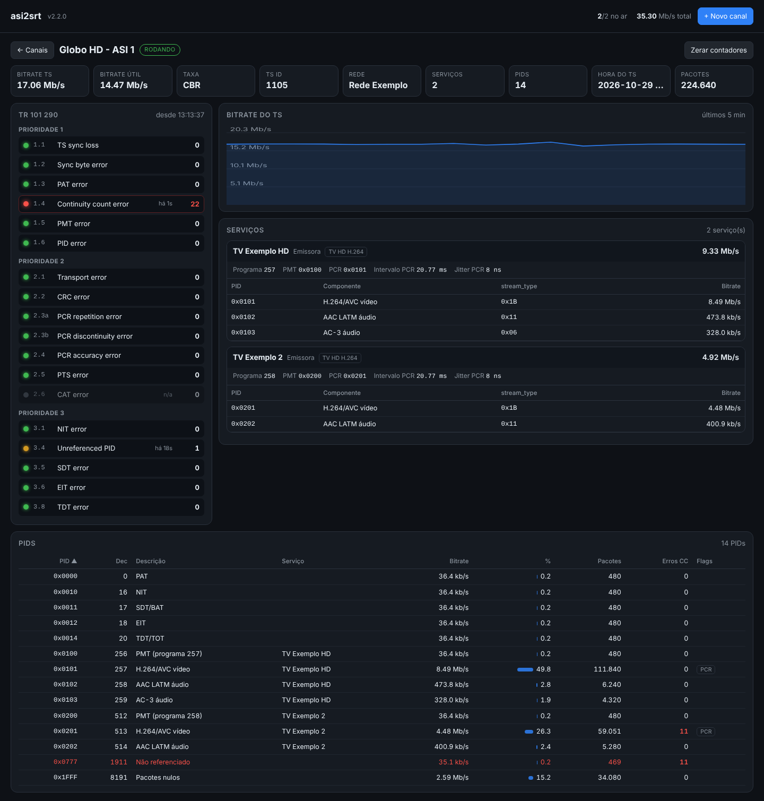

# asi2srt — Gateway ASI / UDP / SRT → SRT / UDP

Um único programa que recebe um transport stream (**placa DVB-ASI**, **UDP/multicast**,
**SRT** ou arquivo) e o reenvia para uma ou mais saídas **SRT** e/ou **UDP**.
Usa o [TSDuck](https://tsduck.io) como motor e inclui **painel web** para gerenciar
os canais, supervisão com reinício automático e monitoração.

```
 Entradas                                                          Saídas (uma ou várias)
 ─────────                                                         ──────────────────────
 DekTec ASI ─┐                                                  ┌─► SRT caller / listener (AES)
 DVEO ASI ───┤                                                  │
 UDP/multic. ┼─► tsp: continuity ─► filter ─► bitrate_monitor ──┼─► UDP unicast / multicast
 SRT ────────┤                                                  │
 Arquivo .ts ┘        painel web :8088 · reinício automático     └─► ...
```

## Instalação

**Binário pronto (não precisa de Python):** baixe em [Releases](../../releases).

```bash
chmod +x asi2srt-linux-amd64 && sudo mv asi2srt-linux-amd64 /usr/local/bin/asi2srt
```

**Ou script Python (3.8+):**

```bash
curl -LO https://raw.githubusercontent.com/BrunoTv01/asi2srt/main/asi2srt.py
chmod +x asi2srt.py && sudo mv asi2srt.py /usr/local/bin/asi2srt
pip install pyyaml   # opcional; sem ele a configuração é salva em JSON
```

Depois:

```bash
sudo asi2srt instalar-tsduck
asi2srt verificar
```

## Só análise (sem saída)

As saídas são opcionais. Um canal sem saída apenas recebe o sinal (SRT, UDP ou ASI) e mostra a
análise completa — é o padrão ao criar um canal pelo painel. Pela linha de comando, basta omitir `-s`:

```bash
asi2srt rodar -e "srt://187.60.226.82:6001?latency=2000"     # analisa um SRT
asi2srt rodar -e "udp://239.1.1.1:1234?local=10.0.0.5"       # analisa um multicast
asi2srt rodar -e dektec:0:0                                  # analisa uma entrada ASI
```

## Painel web

```bash
asi2srt rodar
```

Abra `http://IP-DO-SERVIDOR:8088` e entre com **admin / admin**. Para trocar, altere
`usuario` e `senha_painel` no arquivo de configuração e reinicie o serviço.


Pelo painel você:
- cria, edita e exclui canais
- escolhe a entrada (DekTec, Linux ASI, UDP, SRT, arquivo)
- adiciona várias saídas SRT e UDP por canal
- inicia, para e reinicia cada canal
- acompanha bitrate (com gráfico), indicadores TR 101 290, reinícios e uptime
- vê o log de cada canal

Tudo que é alterado no painel é salvo no arquivo de configuração e sobrevive a reinícios.

## Análise do TS (estilo analisador profissional)

Cada canal analisa o TS **logo depois da entrada**, antes de qualquer filtro. No card aparecem as
6 luzes da Prioridade 1 e o total de P2/P3; o botão **Análise** abre a tela completa do canal:



- **TR 101 290** com as três prioridades, contador e "há quanto tempo" de cada indicador
- **Serviços** (SDT + PAT/PMT): nome, provedor, tipo, PMT, PCR, intervalo e jitter de PCR, componentes com bitrate
- **Tabela de PIDs** ordenável: descrição, serviço, bitrate, %, pacotes, erros CC por PID, PCR, embaralhado, ausente
- **Gráfico** do bitrate do TS (5 min) e resumo: bitrate total e útil, CBR/VBR, TS ID, rede (NIT), hora do TS (TDT/TOT)

| Prioridade | Indicador | O que conta |
|---|---|---|
| 1 | 1.1 TS sync loss | 2+ sync bytes errados seguidos, ou perda do sinal de entrada (> 1 s sem pacotes) |
| 1 | 1.2 Sync byte error | sync byte diferente de `0x47` |
| 1 | 1.3 PAT error | PAT ausente > 0,5 s, `table_id` errado ou embaralhada |
| 1 | 1.4 Continuity count error | CC fora de ordem, pacote perdido ou duplicado mais de uma vez |
| 1 | 1.5 PMT error | PMT ausente > 0,5 s, `table_id` errado ou embaralhada |
| 1 | 1.6 PID error | PID citado na PMT ausente > 5 s |
| 2 | 2.1 Transport error | `transport_error_indicator` = 1 |
| 2 | 2.2 CRC error | CRC32 inválido em PAT, CAT, PMT, NIT, SDT, EIT, TOT |
| 2 | 2.3a PCR repetition | intervalo entre PCRs > 40 ms |
| 2 | 2.3b PCR discontinuity | salto de PCR fora de 0–100 ms sem `discontinuity_indicator` |
| 2 | 2.4 PCR accuracy | jitter de PCR > ±500 ns (só em TS CBR, com pacotes nulos) |
| 2 | 2.5 PTS error | PTS ausente > 700 ms em vídeo/áudio |
| 2 | 2.6 CAT error | pacotes embaralhados sem CAT, ou `table_id` errado no PID 1 |
| 3 | 3.1 NIT error | NIT actual ausente > 10 s ou `table_id` inválido no PID 0x10 |
| 3 | 3.4 Unreferenced PID | PID presente sem referência em PAT/PMT/CAT/SI |
| 3 | 3.5 SDT error | SDT actual ausente > 2 s ou `table_id` inválido no PID 0x11 |
| 3 | 3.6 EIT error | EIT p/f ausente > 2 s ou `table_id` inválido no PID 0x12 |
| 3 | 3.8 TDT error | TDT/TOT ausente > 30 s ou `table_id` inválido no PID 0x14 |

Cores: verde = sem erros, amarelo = já houve erros, vermelho = erro nos últimos 10 s, cinza = não se
aplica a este TS (por exemplo, PCR accuracy em TS VBR, ou NIT/SDT/EIT/TDT que o feed nunca transmitiu —
as verificações de P3 só começam depois que a tabela foi vista uma vez, porque muitos feeds de
contribuição não carregam SI).

Os dados também estão em `GET /api/canais/{id}/analise` (JSON) e os contadores no `status.json`.
Zerar: botão **Zerar** ou `POST /api/canais/{id}/zerar`. A análise pode ser desligada por canal.

Observação: placas e drivers ASI normalmente descartam pacotes sem sync antes de entregá-los
ao software, então na prática o "TS sync loss" aparece sobretudo como perda do sinal de entrada.

## Linha de comando (sem painel nem arquivo)

```bash
# DekTec 0, porta 0 -> SRT caller
asi2srt rodar -e dektec:0:0 -s "srt://203.0.113.10:9000?latency=300"

# ASI (DVEO) -> SRT listener com AES + cópia em multicast
asi2srt rodar -e linuxasi:/dev/asirx0 \
  -s "srt://:9000?mode=listener&passphrase=minhasenha123" \
  -s "udp://239.1.1.1:1234?ttl=16"

# SRT recebido -> UDP multicast (retorno / recepção)
asi2srt rodar -e "srt://:9000?mode=listener" -s "udp://239.10.0.1:5000?local=10.0.0.5"

# UDP multicast -> SRT para um servidor com stream id
asi2srt rodar -e "udp://239.1.1.1:1234?local=10.0.0.5" \
  -s "srt://srt.exemplo.com:8080?streamid=publish/live/canal1"
```

| Entrada | Formato |
|---|---|
| DekTec (DTA-2145, DTA-2138, DTU-245…) | `dektec:PLACA:CANAL` |
| Driver Linux ASI (DVEO / Computer Modules) | `linuxasi:/dev/asirxN` |
| UDP / multicast | `udp://IP:PORTA?local=IP_DA_NIC` |
| SRT listener / caller | `srt://:PORTA?mode=listener` · `srt://HOST:PORTA` |
| Arquivo .ts em loop | `arquivo:caminho.ts` |

| Saída | Formato |
|---|---|
| SRT | `srt://HOST:PORTA?mode=caller\|listener&latency=MS&passphrase=SENHA&pbkeylen=16&streamid=ID` |
| UDP | `udp://IP:PORTA?ttl=N&local=IP_DA_NIC` |

Repita `-s` para várias saídas. A primeira é a principal; as demais recebem uma cópia.

## Arquivo de configuração

```bash
asi2srt init                     # cria asi2srt.yaml comentado
asi2srt comando -c asi2srt.yaml  # mostra os comandos tsp sem executar
asi2srt rodar -c asi2srt.yaml
```

## Serviço (inicia no boot)

```bash
sudo asi2srt instalar-servico
sudo systemctl enable --now asi2srt
# painel: http://IP:8088  (admin / admin)
```

## Monitoração externa

`http://IP:8088/status.json` (autenticação básica) — para Zabbix, Grafana etc.

## API

Todas as rotas usam autenticação básica. Rotas que alteram algo exigem o cabeçalho `X-Asi2srt: 1`.

| Método | Rota | Função |
|---|---|---|
| GET | `/api/canais` | lista canais e status |
| POST | `/api/canais` | cria canal |
| PUT / DELETE | `/api/canais/{id}` | edita / exclui |
| POST | `/api/canais/{id}/iniciar` · `parar` · `reiniciar` · `zerar` | controle |
| GET | `/api/canais/{id}/analise` | análise completa (TR 101 290, PIDs, serviços) |
| GET | `/api/canais/{id}/log` · `comando` | log / comando tsp |

## Teste sem hardware

```bash
asi2srt teste
```

Gera um TS com ffmpeg e o envia em SRT (porta 9000) e UDP (127.0.0.1:5000).
Painel em `http://127.0.0.1:8088` (admin / admin).

## Dicas

- **Latência SRT:** 3–4× o RTT. Internet pública: 500–2000 ms. LAN/MPLS: 120–200 ms.
- **Pacotes nulos:** removidos por padrão para economizar banda. Desligue se o receptor exigir CBR.
- **Multicast:** informe o IP da placa de rede (`local=` / "IP da interface") em servidores com várias NICs.
- **DekTec:** precisa do driver DekTec e do TSDuck com plugin `dektec`.
- **DVEO:** configure o driver para pacotes de 188 bytes.
- **Segurança:** o painel controla o gateway. Não exponha a porta 8088 na internet; use VPN ou firewall.

## Gerar uma versão (binário)

```bash
git tag v2.2.0 && git push origin v2.2.0
```

## Licença

MIT
