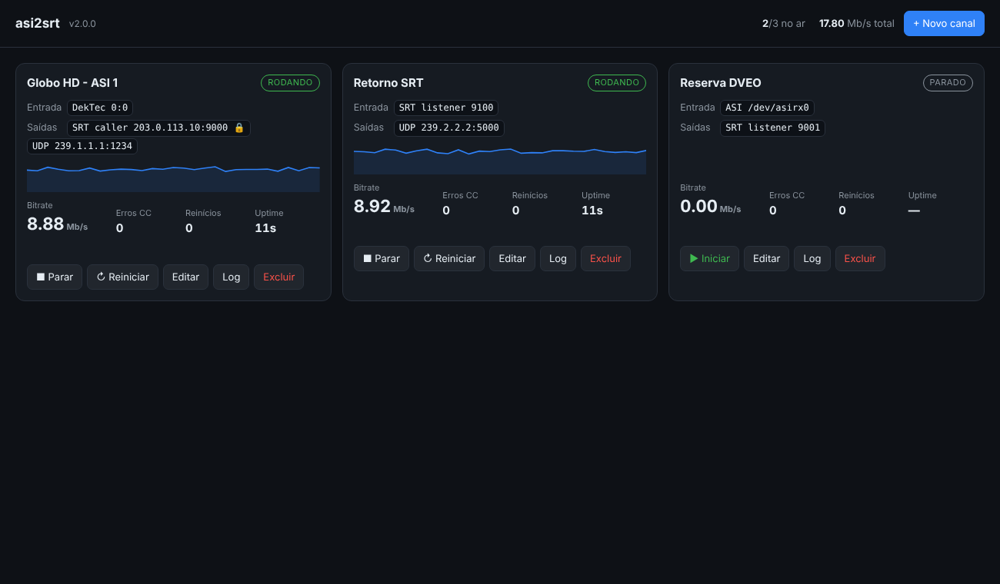
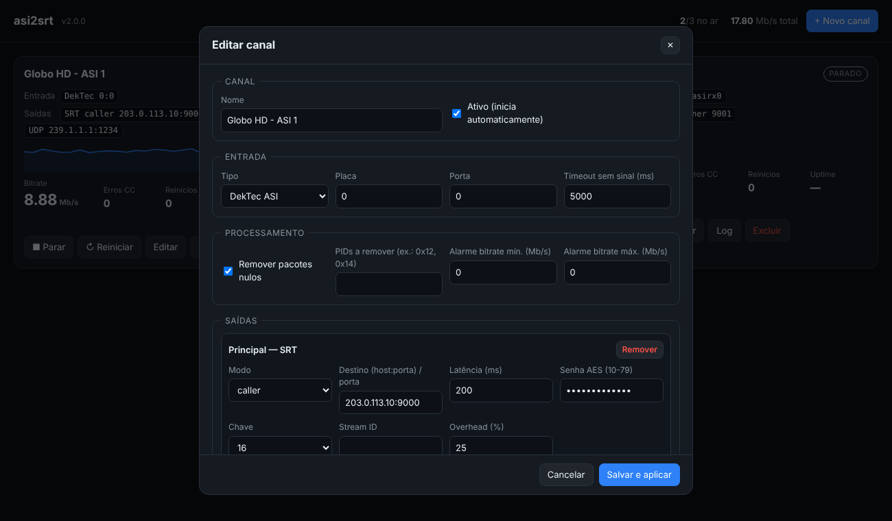
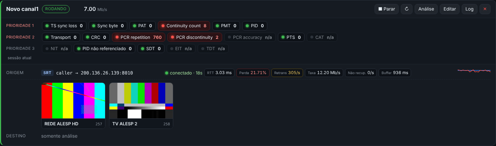
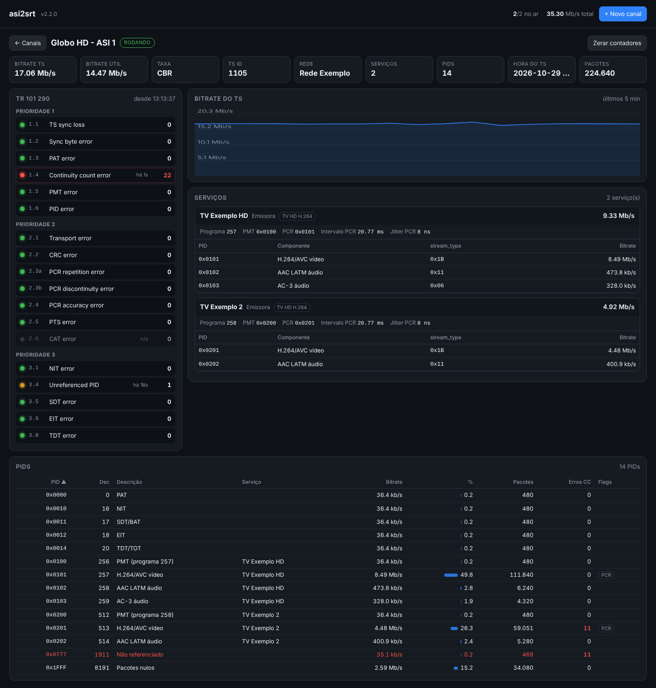

# asi2srt — Gateway ASI / UDP / SRT → SRT / UDP

Um único programa que recebe um transport stream (**placa DVB-ASI**, **UDP/multicast**,
**SRT** ou arquivo) e o reenvia para uma ou mais saídas **SRT** e/ou **UDP**.
Usa o [TSDuck](https://tsduck.io) como motor e inclui **painel web** para gerenciar
os canais, supervisão com reinício automático e monitoração.

```
 Entradas                                                          Saídas (uma ou várias)
 ─────────                                                         ──────────────────────
 DekTec ASI ─┐                                                  ┌─► SRT caller / listener (AES)
 DVEO ASI ───┤                                                  │
 UDP/multic. ┼─► tsp: continuity ─► filter ─► bitrate_monitor ──┼─► UDP unicast / multicast
 SRT ────────┤                                                  │
 Arquivo .ts ┘        painel web :8088 · reinício automático     └─► ...
```

## Instalação rápida (um comando)

Em um Raspberry Pi, Ubuntu ou Debian recém-instalado:

```bash
curl -fsSL https://raw.githubusercontent.com/BrunoTv01/asi2srt/main/instalar.sh | sudo bash
```

Instala as dependências, o asi2srt, o TSDuck e o serviço (inicia no boot), e mostra o endereço do
painel (login `admin` / `admin`). Para atualizar, rode o mesmo comando de novo.

## Servidor com placa DekTec (tudo junto)

Num servidor PC (Intel/AMD) com placa DekTec PCIe (DTA) ou USB (DTU), o mesmo comando instala
também o **driver da DekTec** — ele detecta a placa sozinho:

1. Baixe o **Linux SDK** da DekTec em <https://www.dektec.com/downloads/SDK/> (arquivo `LinuxSDK_v*.tar.gz`;
   a DekTec não oferece link fixo) e deixe na pasta **Downloads** (ou em `/tmp`).
2. Rode:

```bash
curl -fsSL https://raw.githubusercontent.com/BrunoTv01/asi2srt/main/instalar.sh | sudo bash
# ou indicando o SDK:
curl -fsSL https://raw.githubusercontent.com/BrunoTv01/asi2srt/main/instalar.sh | sudo DEKTEC_SDK=/caminho/LinuxSDK_v2025.03.0.tar.gz bash
```

O instalador detecta a placa (PCI/USB), instala DKMS, compilador e headers do kernel, instala o driver
pelo instalador DKMS do próprio SDK (recompila sozinho a cada atualização de kernel) e carrega o módulo.
Se pedir, reinicie (`sudo reboot`). Com **Secure Boot** ativo, drivers não assinados não carregam:
desative-o na BIOS/UEFI ou registre a chave do DKMS.

Depois, no painel, crie o canal com **Entrada = ASI — placa DekTec** (Placa `0`, Porta `0` = primeira
entrada). Portas bidirecionais (ex.: DTA-2145) podem precisar ser postas em entrada: `tsdektec --input 1 0`.
Uma porta só pode ser usada por um programa por vez (feche o StreamXpert se ele estiver usando a porta).

Só o driver: `sudo asi2srt instalar-dektec [--sdk arquivo.tar.gz]` · Conferir: `asi2srt verificar` e `tsdektec -a -v`.

## Raspberry Pi

| | |
|---|---|
| **Modelos** | Raspberry Pi 4 ou 5 (recomendado). Pi 3 funciona para poucos canais de baixa taxa. |
| **Sistema** | Raspberry Pi OS **64 bits** (recomendado) ou 32 bits; Ubuntu Server para Raspberry também serve. |
| **Entradas** | **SRT** e **UDP/multicast**. Placas ASI (DekTec, DVEO) **não funcionam em ARM** — os drivers só existem para PC Intel/AMD. Para analisar ASI no Raspberry, use um conversor ASI→IP na frente. |
| **Rede** | Prefira cabo. Para multicast, informe o IP da interface no canal. |
| **TSDuck** | Instalado automaticamente do pacote oficial (`debian12_arm64` / `raspbian12_armhf`). Se não houver pacote para o seu sistema, `COMPILAR=1` compila do código-fonte (1 a 3 horas). |

Desempenho: a análise TR 101 290 roda em Python puro e processa mais de 1 Gb/s em um PC;
num Raspberry Pi 4 a expectativa é algo na casa de 100–200 Mb/s no total, folgado para vários
canais SRT/UDP típicos (5–40 Mb/s cada). Acompanhe a CPU com `htop`.

Compilar o TSDuck manualmente (quando não há pacote pronto):

```bash
curl -fsSL https://raw.githubusercontent.com/BrunoTv01/asi2srt/main/instalar.sh | sudo COMPILAR=1 bash
# ou, com o asi2srt já instalado:
sudo asi2srt instalar-tsduck --compilar
```

## Instalação

**Binário pronto (não precisa de Python):** baixe em [Releases](../../releases).

```bash
chmod +x asi2srt-linux-amd64 && sudo mv asi2srt-linux-amd64 /usr/local/bin/asi2srt
```

**Ou script Python (3.8+):**

```bash
curl -LO https://raw.githubusercontent.com/BrunoTv01/asi2srt/main/asi2srt.py
chmod +x asi2srt.py && sudo mv asi2srt.py /usr/local/bin/asi2srt
pip install pyyaml   # opcional; sem ele a configuração é salva em JSON
```

Depois:

```bash
sudo asi2srt instalar-tsduck
asi2srt verificar
```

## Tipos de saída

| Saída | Como | Observações |
|---|---|---|
| **SRT** | TSDuck | caller ou listener, AES, stream ID, estatísticas do link |
| **UDP** | TSDuck | unicast ou multicast (TTL, interface) |
| **RTP** | TSDuck (`--rtp`) | unicast ou multicast; payload type (padrão 33 = MP2T) e SSRC configuráveis |
| **RTMP / RTMPS** | ffmpeg | YouTube, Facebook, Wowza, nginx-rtmp… Servidor e chave em campos separados (a chave nunca aparece no log). RTMP aceita H.264 + AAC: por padrão **copia o vídeo e converte o áudio para AAC** (ISDB-Tb usa AAC LATM). Para origem MPEG-2/HEVC, escolha vídeo `h264` (usa CPU). Em MPTS, informe o número do programa. |

Cada saída roda em processo próprio: se uma falhar, só ela tenta de novo, sem afetar a entrada e as outras.

Quando a saída está no ar, a rota e o painel **Saídas e conexões** (tela de análise) mostram: taxa
realmente enviada (medida no próprio processo da saída), há quanto tempo está no ar, total enviado na
conexão e na sessão, tempo total no ar, número de conexões e de quedas, gráfico da taxa e — nas saídas
SRT — RTT, perda, retransmissões, banda do link, buffer e o endereço do outro lado; nas RTMP, a
velocidade do ffmpeg. Esses dados também ficam no relatório salvo ao parar o canal.
Linha de comando: `-s "rtp://239.2.2.2:5004?ttl=8"` · `-s "rtmp://a.rtmp.youtube.com/live2/SUA-CHAVE"`.

## Só análise (sem saída)

As saídas são opcionais. Um canal sem saída apenas recebe o sinal (SRT, UDP ou ASI) e mostra a
análise completa — é o padrão ao criar um canal pelo painel. Pela linha de comando, basta omitir `-s`:

```bash
asi2srt rodar -e "srt://187.60.226.82:6001?latency=2000"     # analisa um SRT
asi2srt rodar -e "udp://239.1.1.1:1234?local=10.0.0.5"       # analisa um multicast
asi2srt rodar -e dektec:0:0                                  # analisa uma entrada ASI
```

## Painel web

```bash
asi2srt rodar
```

Abra `http://IP-DO-SERVIDOR:8088` e entre com **admin / admin**. Troque a senha pelo menu do usuário
(canto superior direito) e crie os outros usuários em **Usuários e permissões** (veja "Acesso" abaixo).





Pelo painel você:
- cria, edita e exclui canais
- escolhe a entrada (DekTec, Linux ASI, UDP, SRT, arquivo)
- adiciona várias saídas SRT e UDP por canal
- inicia, para e reinicia cada canal
- acompanha bitrate (com gráfico), indicadores TR 101 290, reinícios e uptime
- vê o log de cada canal

Tudo que é alterado no painel é salvo no arquivo de configuração e sobrevive a reinícios.

**Nome e logo:** o painel se chama **Engenharia TV Cultura** (configurável). No botão **⚙ (Aparência)**
dá para trocar o nome e enviar o logo (PNG, JPG, SVG ou WebP, até 2 MB). O logo fica salvo no
servidor junto da configuração (`/etc/asi2srt/logo-painel.*`) e aparece no topo e na aba do navegador. O instalador já
coloca o logo padrão (`marca/logo-tv-cultura.png`); se ele for removido pelo painel, as atualizações não o recolocam.

## Acesso: login, usuários e perfis

O painel abre numa **tela de login própria** (com o logo e o nome do painel). Ao entrar, o menu com o
nome do usuário (canto superior direito) tem **Trocar minha senha**, **Usuários e permissões** (só
administrador) e **Sair**.

| Perfil | Pode |
|---|---|
| **Administrador** | tudo: criar, editar e excluir canais, aparência (nome/logo) e usuários |
| **Operador** | ver tudo, iniciar/parar/reiniciar canais, zerar contadores, ver análise e baixar relatórios |

- Login inicial: **admin / admin**. O painel mostra um aviso até a senha padrão ser trocada.
- Senhas ficam no arquivo de configuração só como **hash PBKDF2** (nunca em texto). O arquivo fica
  com permissão 600.
- A sessão vale **12 h sem uso** (no máximo 30 dias) e continua depois de reiniciar o serviço. Trocar a
  senha ou excluir um usuário encerra as sessões dele.
- **5 senhas erradas** em 10 min bloqueiam aquele IP por 5 min.
- Scripts e monitoração externa continuam funcionando com usuário e senha no cabeçalho
  (`curl -u usuario:senha http://servidor:8088/status.json`).
- **Esqueceu a senha?** No servidor, coloque `senha_painel: NOVA_SENHA` (e, se quiser, `usuario: admin`)
  em `supervisor:` no `/etc/asi2srt/config.yaml` e reinicie (`sudo systemctl restart asi2srt`). A senha
  é redefinida e a linha some do arquivo.

## Rotas e saúde do SRT

A tela principal mostra cada canal como uma **rota** — origem → destinos — com o estado de cada
conexão SRT atualizado a cada segundo (dá para alternar para a visão em **Cards** no topo):



Para cada conexão SRT (entrada e saídas): estado (conectado / aguardando / conectando), endereço do
outro lado, tempo conectado, **RTT**, **perda** de pacotes, **retransmissões**, taxa, **banda estimada do
link**, **buffer** e latência negociada. Na tela de análise, o painel **Conexões SRT** traz também os
totais da sessão (pacotes, perdidos, retransmitidos, descartados, RTT médio/máximo) e o gráfico de
taxa, RTT e perda. Esses dados entram no relatório salvo ao parar o canal.

As estatísticas vêm do próprio TSDuck (`--statistics-interval 1000 --json-line`), sem custo extra.

**Saídas independentes:** cada destino roda em seu próprio processo. A entrada e a análise ficam num
processo que entrega o TS a um distribuidor local, e o distribuidor manda uma cópia para cada saída.
Se um destino falhar (servidor SRT fora do ar, firewall, porta errada), só ele fica tentando de novo
sozinho — a entrada, a análise e as outras saídas continuam no ar. O motivo da falha aparece na rota.

### Status do servidor

**Máquinas modestas:** a janela de imagem é o que mais gasta (o ffmpeg decodifica os vídeos). Ela já
roda leve (1 thread por vídeo, só quadros-chave, uma imagem a cada 2 s, 320 px) e para sozinha quando
ninguém está com o painel aberto; em **⚙ → Janela de imagem** dá para desligá-la de vez. Com pouca
memória (menos de 4 GB) e o swap em uso, o mais eficaz é aumentar a memória.

No topo do painel fica sempre visível o uso de **CPU**, **memória** e a **temperatura** do processador
(amarelo acima de 70%/75 °C, vermelho acima de 85%). Clicando nele abre **Status do servidor**:

- processador (modelo, uso total e por núcleo, carga média), memória e swap, disco;
- temperaturas dos sensores (em máquina virtual normalmente não há sensores);
- tráfego de cada placa de rede, nome da máquina, sistema, kernel e há quanto tempo está ligada;
- **consumo do próprio asi2srt** (supervisor, processos tsp e ffmpeg: quantidade, CPU e memória);
- gráfico dos últimos 5 minutos de CPU, memória e temperatura.

Tudo é lido de `/proc` e `/sys`, sem instalar nada. API: `GET /api/sistema`.

### Placas de rede reconhecidas

O botão **Rede** (no topo do painel) mostra todas as placas que o servidor reconhece, lidas do sistema
na hora (placa nova ou cabo religado aparecem sozinhos):

- link (verde/vermelho), velocidade e duplex, IPv4/IPv6, gateway, MAC, MTU, endereço PCI;
- **modelo e driver** da placa (via `lspci`; o instalador coloca `pciutils` e `iproute2`);
- tipo: física, Wi-Fi, bond (com as portas membro), VLAN, bridge, VPN;
- tráfego recebido/enviado em tempo real e **quais canais usam a placa** (principal ou reserva);
- aviso de **placa detectada no PCI sem driver** (o sistema não consegue usá-la até instalar o driver).

Interfaces internas (Docker, VMs, containers) ficam escondidas da lista e dos formulários
(há uma opção para mostrá-las). `asi2srt verificar` e o log de início também listam as placas.

### Placa de rede reserva (failover automático)

Cada entrada (UDP/SRT) e cada saída (SRT/UDP/RTP) pode ter uma **placa reserva**. Escolha a
**Placa de rede** (principal) e a **Placa reserva (failover)** no formulário do canal.

- **Cabo/porta caiu ou a placa perdeu o IP:** troca para a reserva em até ~2 s.
- **A conexão não funciona pela placa ativa** (SRT caller sem conectar ou entrada sem sinal por 15 s,
  com a placa "ligada" mas a rede adiante com problema): tenta a outra placa. Se nenhuma funcionar,
  alterna com espera crescente (15 s, 30 s, 60 s, até 2 min) para não ficar trocando sem parar.
- **Volta para a principal** sozinho quando ela fica de volta e estável por 30 s (quando saiu dela por
  link/IP). Se saiu por falta de conexão, fica na reserva enquanto a reserva estiver funcionando.
- Troca de placa **não conta como queda**; a análise continua. A rota mostra **⚠ PLACA RESERVA** e a
  placa em amarelo (`enp2s0 · reserva`); passe o mouse para ver o motivo. O log e os relatórios
  (PDF/HTML/TXT) trazem cada troca com horário e motivo.
- Ajustes em `supervisor.failover` (opcional): `sem_sinal_s: 15`, `voltar_apos_s: 30`.
- **Placas em redes/operadoras diferentes:** para a saída usar mesmo o gateway da placa reserva,
  ative `supervisor.rotas_por_placa: true` (ou rode `sudo asi2srt rotas-por-placa`). Isso cria uma
  regra de rota por origem para cada placa (o tráfego com o IP de uma placa sai pelo gateway dela).
  Se as duas placas estão na mesma rede, não é preciso.
- Alternativa no sistema operacional: *bonding* `active-backup` (duas portas no mesmo switch viram uma
  placa só). Funciona junto, mas só cobre falha de link na mesma rede.

### Comparar sinais

O botão **Comparar** (ao lado de Rotas, Lista e Cards) põe até 6 entradas lado a lado (colunas A, B, C…).
Em **Entradas comparadas**, escolha para cada coluna o **canal** e os **dados**: *Ao vivo* ou uma
**sessão salva** (data e hora). Assim dá para comparar canais diferentes ou o mesmo canal agora × ontem.
**+ Adicionar entrada** cria mais uma coluna; **✕** tira a coluna. A escolha fica salva no navegador.

- **Resumo:** taxa útil, CBR/VBR, nº de serviços e PIDs, total de erros CC e de cada prioridade TR 101 290.
- **Serviços:** cada serviço (pelo número) com bitrate e erros CC em cada sinal; `ausente` quando
  um sinal não tem aquele serviço, `≠` quando o nome muda.
- **PIDs:** Dec, Hex, Descrição e Serviço, com os **Erros CC** de cada entrada. Linha com
  barra amarela = difere entre os sinais; vermelha = tem erro de continuidade.
- Filtros **Só diferenças**, **Só com erros CC** e **Ocultar não referenciados**, e **Baixar CSV** (abre no Excel).
- **↺ Zerar comparação** zera os erros **só nesta tela** (passa a contar a partir daquele momento); o **↺**
  ao lado do nome de cada coluna zera só aquela entrada. Os contadores do canal (Rotas, Análise e relatórios)
  não mudam. A coluna mostra "desde HH:MM:SS ✕"; clicando no ✕ volta ao total.

**Repetição do PCR (2.3a):** o limite padrão é **100 ms** (ISO/IEC 13818-1, usado no ISDB-Tb e recomendado
pela própria TR 101 290 desde 2005, nota 2 da tabela 5.0b). O critério antigo de **40 ms** do DVB pode ser
escolhido em **⚙ → Repetição do PCR**; vale para todos os canais na hora.

**PIDs fora do pacote:** em **⚙ → PIDs fora do pacote** fica a lista de PIDs que vêm no TS mas não
pertencem a nenhum serviço (padrão: 5000, 5016, 5017, 8184). Eles continuam aparecendo nas tabelas, em
cinza ("Fora do pacote"), mas não geram erro: nem "PID não referenciado", nem continuidade (CC). Vale para
todos os canais na hora; aceita decimal ou hexadecimal (`5000, 0x1398`).

PIDs fixos do **ISDB-Tb** (0x20 a 0x2F: BIT, SDTT, CDT, EIT M/L etc.; 0x1FF0 IIP do SFN; 0x1FC8–0x1FCF PMT 1-seg) são reconhecidos pelo nome e não
contam mais como "PID não referenciado".

### Muitos sinais: visão compacta e Lista

- **Rotas** (padrão compacto): os indicadores TR 101 290 ficam numa linha só por canal, mostrando
  **apenas os que têm ocorrência** (`P2 · PCR repetition 707 · PCR discontinuity 15 · +3 ok`); o resto
  aparece como "✓ N ok". Imagem e gráfico ficam menores. O botão **▾** de cada canal abre os
  detalhes completos (todos os indicadores e imagens maiores) e o painel lembra quais estão abertos.
- **Lista**: uma linha por sinal, com miniatura, estado, taxa útil, CBR/VBR, total de ocorrências
  P1/P2/P3 (cor = situação; passe o mouse para ver quais), entrada (com RTT e perda do SRT), saídas
  no ar e botões. Ideal para monitorar dezenas de sinais numa tela só.

## Taxa: total, útil, por serviço, CBR ou VBR

A rota, o card, o gráfico e os relatórios mostram só a **taxa útil** (o conteúdo, sem os pacotes nulos
de enchimento); a taxa total do TS, com nulos, fica na tela de Análise. Cada janela de serviço mostra a
**taxa do serviço**. As saídas removem os nulos e nada é acrescentado. O sistema também classifica:

- **TS CBR ou VBR:** CBR quando a taxa total varia menos de 2% (típico de mux com enchimento);
- **cada serviço CBR ou VBR:** CBR quando a taxa do serviço varia menos de 3%.

A medição usa o **relógio do próprio fluxo (PCR)**: pacotes entre dois PCRs divididos pelo tempo entre
eles, como fazem os analisadores profissionais. Por isso não é enganada por atraso de rede nem por
carga do computador. O selo mostra a variação (ex.: `VBR ±4.7%`) e o mínimo/máximo ao passar o mouse.
Os primeiros ~8 s aparecem como "medindo…".

## Placa de rede de entrada e saída

Em computadores com mais de uma placa de rede, cada entrada (UDP, SRT) e cada saída (SRT, UDP, RTP)
tem o menu **Placa de rede**, que lista as placas do computador com o IP de cada uma
(`asi2srt verificar` também lista). "Automática" deixa o sistema escolher pela rota.

| Conexão | O que a placa escolhida faz |
|---|---|
| Entrada UDP/multicast | recebe por aquela placa (o multicast é assinado nela) |
| Entrada/saída SRT caller | a conexão sai por aquela placa (`--local-interface`) |
| Entrada/saída SRT listener | escuta só no IP daquela placa |
| Saída UDP/RTP | multicast sai por aquela placa; em unicast vale a rota do sistema |
| Saída RTMP | sempre pela rota do sistema |

A placa é guardada pelo nome (ex.: `enp2s0`), então continua certa mesmo se o IP mudar por DHCP
(basta reiniciar o canal). Linha de comando: `?interface=enp2s0`.

## Serviços e janela de imagem

- **Escolher o serviço de cada saída:** no formulário, cada destino lista os serviços que estão
  chegando na entrada (caixas de seleção). Nenhum marcado = TS completo. Com serviços marcados, o
  TSDuck (`zap --ignore-absent`) refaz PAT/PMT/SDT só com eles; se o serviço sumir por um momento,
  a saída continua e volta sozinha. Na saída RTMP vai um serviço só. Linha de comando: `?servico=257,258`.
- **Janela de imagem:** a rota mostra uma miniatura ao vivo de cada serviço que entra (contorno azul =
  serviço que está saindo em algum destino) e cada destino mostra o serviço que envia. Na tela de
  análise cada serviço tem sua janela e a lista "Sai em" com os destinos que o levam.
- **Gráfico ao lado da imagem:** na rota, ao lado das janelas, fica o gráfico da taxa útil do último
  minuto (azul), com mínimo, máximo e CBR/VBR. Se a entrada for SRT, a linha vermelha mostra a perda.
  As imagens são geradas pelo ffmpeg decodificando **só os quadros-chave** (cerca de 6% de um núcleo
  para dois serviços HD) e só enquanto alguém está com o painel aberto.

## Análise do TS (estilo analisador profissional)

Cada canal analisa o TS **logo depois da entrada**, antes de qualquer filtro. No card aparecem as
6 luzes da Prioridade 1 e o total de P2/P3; o botão **Análise** abre a tela completa do canal:



- **TR 101 290** com as três prioridades, contador e "há quanto tempo" de cada indicador
- **Serviços** (SDT + PAT/PMT): nome, provedor, tipo, PMT, PCR, intervalo e jitter de PCR, componentes com bitrate
- **Tabela de PIDs** ordenável: descrição, serviço, bitrate, %, pacotes, erros CC por PID, PCR, embaralhado, ausente
- **Gráfico** do bitrate do TS (5 min) e resumo: bitrate total e útil, CBR/VBR, TS ID, rede (NIT), hora do TS (TDT/TOT)

| Prioridade | Indicador | O que conta |
|---|---|---|
| 1 | 1.1 TS sync loss | 2+ sync bytes errados seguidos, ou perda do sinal de entrada (> 1 s sem pacotes) |
| 1 | 1.2 Sync byte error | sync byte diferente de `0x47` |
| 1 | 1.3 PAT error | PAT ausente > 0,5 s, `table_id` errado ou embaralhada |
| 1 | 1.4 Continuity count error | CC fora de ordem, pacote perdido ou duplicado mais de uma vez |
| 1 | 1.5 PMT error | PMT ausente > 0,5 s, `table_id` errado ou embaralhada |
| 1 | 1.6 PID error | PID citado na PMT ausente > 5 s |
| 2 | 2.1 Transport error | `transport_error_indicator` = 1 |
| 2 | 2.2 CRC error | CRC32 inválido em PAT, CAT, PMT, NIT, SDT, EIT, TOT |
| 2 | 2.3a PCR repetition | intervalo entre PCRs > 40 ms |
| 2 | 2.3b PCR discontinuity | salto de PCR fora de 0–100 ms sem `discontinuity_indicator` |
| 2 | 2.4 PCR accuracy | jitter de PCR > ±500 ns (só em TS CBR, com pacotes nulos) |
| 2 | 2.5 PTS error | PTS ausente > 700 ms em vídeo/áudio |
| 2 | 2.6 CAT error | pacotes embaralhados sem CAT, ou `table_id` errado no PID 1 |
| 3 | 3.1 NIT error | NIT actual ausente > 10 s ou `table_id` inválido no PID 0x10 |
| 3 | 3.4 Unreferenced PID | PID presente sem referência em PAT/PMT/CAT/SI |
| 3 | 3.5 SDT error | SDT actual ausente > 2 s ou `table_id` inválido no PID 0x11 |
| 3 | 3.6 EIT error | EIT p/f ausente > 2 s ou `table_id` inválido no PID 0x12 |
| 3 | 3.8 TDT error | TDT/TOT ausente > 30 s ou `table_id` inválido no PID 0x14 |

Cores: verde = sem erros, amarelo = já houve erros, vermelho = erro nos últimos 10 s, cinza = não se
aplica a este TS (por exemplo, PCR accuracy em TS VBR, ou NIT/SDT/EIT/TDT que o feed nunca transmitiu —
as verificações de P3 só começam depois que a tabela foi vista uma vez, porque muitos feeds de
contribuição não carregam SI).

Os dados também estão em `GET /api/canais/{id}/analise` (JSON) e os contadores no `status.json`.
Zerar: botão **Zerar** ou `POST /api/canais/{id}/zerar`. A análise pode ser desligada por canal.

Observação: placas e drivers ASI normalmente descartam pacotes sem sync antes de entregá-los
ao software, então na prática o "TS sync loss" aparece sobretudo como perda do sinal de entrada.

### Relatórios salvos

Ao parar um canal (ou desligar o serviço), a análise da sessão é **salva**: o card do canal parado
mostra o resumo (período, duração, bitrate médio/mín/máx, erros TR 101 290, serviços) e
**Ver relatório** abre a análise completa como estava no fim da sessão. A tela de análise tem um
seletor com as **últimas 20 sessões** de cada canal e os botões **Baixar relatório: PDF · HTML · TXT · JSON**:

- **PDF** – relatório em A4 com o logo, tabela TR 101 290 em cores, serviços, PIDs, SRT e saídas,
  com número de página. Pronto para enviar por e-mail ou arquivar (usa `python3-reportlab`, que o
  instalador já coloca).
- **HTML** – relatório formatado com o logo do painel, tabela TR 101 290 em cores, serviços, PIDs,
  SRT e saídas. Abre no navegador e pode ser impresso ou salvo em PDF (Ctrl+P).
- **TXT** – o mesmo conteúdo em texto simples, bom para e-mail ou anexar em chamados.
- **JSON** – dados completos, para integrar com outros sistemas.

Funciona tanto com o canal rodando (análise ao vivo) quanto com sessões salvas. Senhas SRT e
chaves RTMP nunca aparecem no relatório.

Os relatórios ficam em `<arquivo-de-config>-relatorios.json` (ex.: `/etc/asi2srt/config-relatorios.json`)
e a sessão em andamento é salva a cada 60 s, então nada se perde se o programa cair.
API: `GET /api/canais/{id}/relatorios` e `GET /api/canais/{id}/analise?sessao=N[&baixar=1&formato=html|txt|json]`.

## Linha de comando (sem painel nem arquivo)

```bash
# DekTec 0, porta 0 -> SRT caller
asi2srt rodar -e dektec:0:0 -s "srt://203.0.113.10:9000?latency=300"

# ASI (DVEO) -> SRT listener com AES + cópia em multicast
asi2srt rodar -e linuxasi:/dev/asirx0 \
  -s "srt://:9000?mode=listener&passphrase=minhasenha123" \
  -s "udp://239.1.1.1:1234?ttl=16"

# SRT recebido -> UDP multicast (retorno / recepção)
asi2srt rodar -e "srt://:9000?mode=listener" -s "udp://239.10.0.1:5000?local=10.0.0.5"

# UDP multicast -> SRT para um servidor com stream id
asi2srt rodar -e "udp://239.1.1.1:1234?local=10.0.0.5" \
  -s "srt://srt.exemplo.com:8080?streamid=publish/live/canal1"
```

| Entrada | Formato |
|---|---|
| DekTec (DTA-2145, DTA-2138, DTU-245…) | `dektec:PLACA:CANAL` |
| Driver Linux ASI (DVEO / Computer Modules) | `linuxasi:/dev/asirxN` |
| UDP / multicast | `udp://IP:PORTA?local=IP_DA_NIC` |
| SRT listener / caller | `srt://:PORTA?mode=listener` · `srt://HOST:PORTA` |
| Arquivo .ts em loop | `arquivo:caminho.ts` |

| Saída | Formato |
|---|---|
| SRT | `srt://HOST:PORTA?mode=caller\|listener&latency=MS&passphrase=SENHA&pbkeylen=16&streamid=ID` |
| UDP | `udp://IP:PORTA?ttl=N&local=IP_DA_NIC` |

Repita `-s` para várias saídas. A primeira é a principal; as demais recebem uma cópia.

## Arquivo de configuração

```bash
asi2srt init                     # cria asi2srt.yaml comentado
asi2srt comando -c asi2srt.yaml  # mostra os comandos tsp sem executar
asi2srt rodar -c asi2srt.yaml
```

## Serviço (inicia no boot)

```bash
sudo asi2srt instalar-servico
sudo systemctl enable --now asi2srt
# painel: http://IP:8088  (admin / admin)
```

## Monitoração externa

`http://IP:8088/status.json` (autenticação básica) — para Zabbix, Grafana etc.

## API

Todas as rotas usam autenticação básica. Rotas que alteram algo exigem o cabeçalho `X-Asi2srt: 1`.

| Método | Rota | Função |
|---|---|---|
| GET | `/api/canais` | lista canais e status |
| POST | `/api/canais` | cria canal |
| PUT / DELETE | `/api/canais/{id}` | edita / exclui |
| POST | `/api/canais/{id}/iniciar` · `parar` · `reiniciar` · `zerar` | controle |
| GET | `/api/canais/{id}/analise` | análise completa (TR 101 290, PIDs, serviços) |
| GET | `/api/canais/{id}/log` · `comando` | log / comando tsp |

## Teste sem hardware

```bash
asi2srt teste
```

Gera um TS com ffmpeg e o envia em SRT (porta 9000) e UDP (127.0.0.1:5000).
Painel em `http://127.0.0.1:8088` (admin / admin).

## PIDs analisados

Por padrão (⚙ → **PIDs analisados**), o sistema lê **só os PIDs monitorados**: os da PAT e das PMTs (vídeo, áudio, dados, PCR), as tabelas SI (0x00 a 0x1F e as do ISDB-Tb), os PIDs "fora do pacote" e o nulo. Qualquer outro PID não é lido, não aparece nas listas e não entra no total. PIDs que deixam de ser referenciados (serviço removido da PAT) saem da lista em 10 s. Desligando a opção, voltam a aparecer como "não referenciado" (TR 101 290 3.4). A taxa total continua contando todos os pacotes.

## Registro de acessos

Fica no menu do usuário → **Registro de acessos** (só para admin). Registra:
- **Entradas e saídas:** quem entrou, a hora, o IP e o navegador; logins recusados e bloqueios; troca de senha.
- **Ações:** canal criado, alterado, excluído, iniciado, parado ou reiniciado; contadores zerados; ⚙ alterado; usuários alterados.
- **Serviço:** quando o serviço asi2srt subiu e parou. Se subiu sem ter parado normalmente, registra como **parada anormal** (travamento ou processo encerrado à força). Também registra quando a **máquina foi ligada ou reiniciada**, avisando se antes não houve desligamento normal (provável queda de energia).
- **Reinícios automáticos:** entrada sem sinal, saída travada ou processamento caiu (no máximo um registro por minuto para cada caso).

Os registros ficam em `<config>-auditoria.jsonl` (até 5 MB, mais 1 arquivo anterior) e podem ser baixados em CSV, com filtro por tipo e por usuário.

## TS 188 e BTS 204

O asi2srt aceita pacotes de **188 bytes (TS)** e de **204 bytes (BTS / RS204)**, e reconhece o formato sozinho.

- **Entrada UDP, SRT, arquivo ou ASI pelo driver Linux:** o formato é detectado automaticamente. No BTS do ISDB-Tb, os 16 bytes finais de cada pacote trazem a informação ISDB-T, e a análise mostra **Pacote: BTS 204 (ISDB-T)** e a **taxa por camada (A, B, C)**.
- **Entrada ASI pela DekTec:** o TSDuck recebe sempre em 188 (a placa descarta os 16 bytes finais). O conteúdo é analisado normalmente. Quando a taxa e o PID 0x1FF0 (IIP) indicam BTS, a análise avisa "origem provavelmente BTS 204".
- **Saídas SRT, UDP e RTP:** campo **Pacote** com 188 (padrão, TS) ou 204 (BTS: mantém os 16 bytes da entrada; se a entrada era 188, o trailer sai preenchido com 0xFF).
- Precisa do TSDuck 3.39 ou mais novo para levar o trailer até as saídas. Com versão antiga, o 204 é aceito, mas tudo sai em 188.

## Subida automática (reinício e queda de energia)

O instalador já deixa tudo pronto. Para aplicar ou reaplicar só esta parte, rode `sudo asi2srt inicio-automatico`. Ela faz quatro ajustes:
- habilita o serviço `asi2srt` no boot (os canais ativos sobem sozinhos);
- carrega o driver DekTec no boot (`/etc/modules-load.d/dektec.conf`);
- evita que o boot fique 2 minutos esperando uma placa de rede sem cabo: basta uma placa com link, com no máximo 30 s de espera;
- depois de uma queda de energia, o GRUB do Ubuntu segue sozinho em 5 s em vez de parar no menu, e o disco é corrigido automaticamente (`fsck.repair=yes`).

Falta só **um ajuste na BIOS**: "Restore on AC Power Loss" (ou "After Power Failure") = **Power On**.

O `asi2srt verificar` mostra se a subida automática está completa. No Docker, use `restart: unless-stopped` (já no compose) e `sudo systemctl enable docker`.

## Docker

O asi2srt também roda em container. A imagem traz o asi2srt, o TSDuck (plugins srt, ip e dektec), o ffmpeg e o reportlab (PDF).

```bash
git clone https://github.com/BrunoTv01/asi2srt.git && cd asi2srt
docker compose up -d --build
docker compose logs -f
```

Painel: `http://IP-DO-SERVIDOR:8088` (admin/admin no 1º acesso).

- **Rede do host** (`network_mode: host`): obrigatória para multicast, SRT listener, várias placas de rede e placa reserva.
- **Dados** no volume `asi2srt-dados` (`/etc/asi2srt`): configuração, usuários, relatórios e logo. Sobrevivem a atualizações.
- **Ajustes de kernel no HOST** (o container não pode mudar o kernel). Rode uma vez:
  ```bash
  docker run --rm asi2srt sysctl | sudo tee /etc/sysctl.d/90-asi2srt.conf && sudo sysctl -p /etc/sysctl.d/90-asi2srt.conf
  ```
- **Placa DekTec:** o driver é módulo do kernel, então instale no host (`sudo asi2srt instalar-dektec --sdk <URL>`). Depois descomente `devices:` no `docker-compose.yml` com os nomes de `ls /dev/Dta*`.
- **Porta do painel:** `PORTA: "9000"` em `environment`.
- **Atualizar:** `git pull && docker compose up -d --build`.
- **Comandos:** `docker compose exec asi2srt asi2srt verificar`.

## Estabilidade e robustez

### Máquinas modestas (ex.: i3 com 2 GB de RAM)
- **Proteção automática contra sobrecarga** (⚙ → Proteção contra sobrecarga, ligada por padrão): com CPU ≥ 90% por 30 s, memória livre < 8% (ou < 150 MB) ou swap crescendo mais de 100 MB em 1 minuto, as imagens dos serviços pausam sozinhas. O topo mostra **⚠ economia**. Voltam quando o servidor fica normal por 1 minuto. Sinal, análise e saídas nunca são pausados.
- **Memória:** o serviço tem `OOMScoreAdjust=-500` e as imagens `oom_score_adj=1000`, então, se a RAM acabar, o Linux encerra as imagens antes do sinal. `vm.swappiness = 10` evita jogar o processamento para o swap.
- **CPU:** ao iniciar como root, o governador vai para `performance` (sem queda de frequência atrasando pacotes). Desative com `"cpu_desempenho": false` em `supervisor`.

O sistema se protege sozinho dos problemas mais comuns de campo:

- **Entrada muda:** se a entrada para de mandar pacotes mas continua "conectada" (ex.: SRT ativo com
  o encoder parado, driver ASI travado), o canal reinicia a entrada depois de **20 s** sem sinal.
  Ajuste em `processamento.reiniciar_sem_sinal_s` (0 desliga).
- **Saída travada:** uma saída que estava no ar e para de responder por 30 s (com a entrada chegando) é
  reiniciada sozinha, sem mexer nas outras saídas nem na análise.
- **Analisador isolado:** se a cópia para análise falhar, o TSDuck segue com a entrada e as saídas
  (`fork --ignore-abort`); um pacote ou tabela malformada não para a análise.
- **Perda interna:** o sistema compara o que o kernel descartou em cada etapa (análise, distribuidor e
  saídas). Se o próprio servidor perder pacotes (CPU no limite, buffer pequeno), a rota mostra
  **⚠ PERDA INTERNA**. Assim dá para separar erro do sinal de erro do servidor. O total também vai
  para o relatório.
- **Buffers de rede:** o `instalar-servico` grava `/etc/sysctl.d/90-asi2srt.conf` (buffers UDP de 32 MB)
  e cada entrada UDP pede 16 MB. Sem isso o Linux corta o buffer em ~200 KB e rajadas viram perda.
- **Bitrate mínimo/máximo** usam a média de 5 s e ignoram os primeiros segundos depois que o sinal
  volta: uma rajada (rede/SRT segurou e soltou de uma vez) não aparece como "máximo de 60 Mb/s".
  As rajadas são contadas à parte (KPI **Rajadas**).
- **Serviço:** o systemd nunca desiste de religar (`StartLimitIntervalSec=0`). Prioridade alta sem
  tempo real, e a janela de imagem (ffmpeg) roda com prioridade baixa: ela nunca atrasa o fluxo.

## Dicas

- **Latência SRT:** 3–4× o RTT. Internet pública: 500–2000 ms. LAN/MPLS: 120–200 ms.
- **Pacotes nulos:** removidos por padrão para economizar banda. Desligue se o receptor exigir CBR.
- **Multicast:** informe o IP da placa de rede (`local=` / "IP da interface") em servidores com várias NICs.
- **DekTec:** precisa do driver DekTec e do TSDuck com plugin `dektec`.
- **DVEO:** configure o driver para pacotes de 188 bytes.
- **Segurança:** o painel controla o gateway. Não exponha a porta 8088 na internet; use VPN ou firewall.

## Gerar uma versão (binário)

```bash
git tag v2.32.0 && git push origin v2.32.0
```

## Licença

MIT
